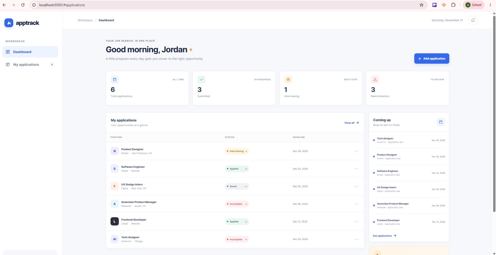
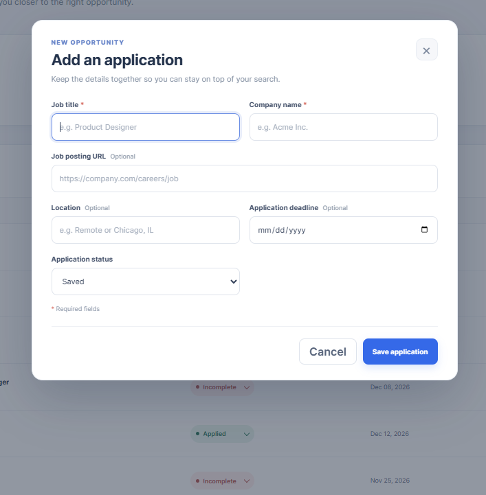

# AppTrack

## Project Description

AppTrack is a job and internship application tracker designed to help college students, recent graduates, and other job seekers stay organized throughout the application process.

Keeping track of job postings, application information, deadlines, and application statuses can become difficult when applying to multiple positions. AppTrack provides one place where users can add job applications, view their saved opportunities, update application statuses, and keep track of upcoming deadlines through a dashboard.

The goal of AppTrack is to make the job search process easier to manage by keeping important application information organized in one place.

## Features

### Implemented Features
- Add job and internship applications.
- Enter company information, application links, locations, and deadlines.
- Track application statuses, including Saved, Incomplete, Applied, Interviewing, and Accepted.
- View all applications through a dashboard.
- View application status labels and summary counts.
- View upcoming application deadlines.
- Update application statuses directly from the dashboard.

### Planned Features
- Edit existing job and internship applications.
- Add and track job requirements.
- Add application notes.
- Set follow-up dates.
- Organize applications by priority.

## Technology Stack

### Currently Used
- Frontend: React
- Build Tool: Vite
- Styling: CSS
- Containerization: Docker
- Web Server: Nginx

### Planned Technologies
- Backend: Node.js and Express
- Database: SQLite
- Container Orchestration: Docker Compose
- CI/CD: GitHub Actions
- Cloud Deployment: Google Cloud Platform (GCP)


## Getting Started

### Prerequisites
- Node.js and npm
- Docker Desktop (for running the Docker container)

### Running Locally

1. Clone the repository:
   ```bash
   git clone https://github.com/barrowsa1/AppTrack---Final-Project.git
   ```

2. Navigate to the frontend folder:
   ```bash
   cd AppTrack---Final-Project/frontend
   ```

3. Install dependencies:
   ```bash
   npm install
   ```

4. Start the development server:
   ```bash
   npm run dev
   ```

5. Open the local URL displayed in the terminal, usually `http://localhost:5173`.

### Running with Docker

1. Navigate to the frontend folder.
2. Build the Docker image:
   ```bash
   docker build -t apptrack-frontend .
   ```
3. Run the container:
   ```bash
   docker run --name apptrack-frontend-container -d -p 8080:8080 apptrack-frontend
   ```
4. Open `http://localhost:8080` in your browser.

To stop and remove the container:

```bash
docker stop apptrack-frontend-container
docker rm apptrack-frontend-container
```


## Usage

AppTrack provides a dashboard where users can view and organize their job and internship applications.

Users can:
- View all saved applications in the dashboard.
- Add a new job or internship application using the Add Application form.
- Enter the job title, company name, application URL, location, deadline, and application status.
- Update an application's status directly from the dashboard.
- View application status counts and upcoming deadlines.

Application information is currently stored in the application's state and will reset when the page is refreshed. Database storage is planned for a future development stage.


## Screenshots

### AppTrack Dashboard


### Add Application Form


More screenshots of the AppTrack dashboard and application features will be added here as development continues.


## AI Integration

ChatGPT and GitHub Copilot are being used throughout development to help with application planning, code suggestions, troubleshooting, and understanding unfamiliar code.

ChatGPT has helped with reviewing implementation decisions, explaining code, and identifying improvements. GitHub Copilot has assisted with code development and suggestions.

AI-generated code and suggestions are reviewed and tested before being included in the project.


## Project Status

AppTrack is currently being developed as part of the Modern Tech final project.

The Unit 12 MVP includes a working dashboard, the ability to add job and internship applications, view application details, and update application statuses. The frontend has also been containerized with Docker and successfully tested locally.

Additional features, backend functionality, database integration, and cloud deployment will be developed as the project continues toward the final Unit 14 submission.